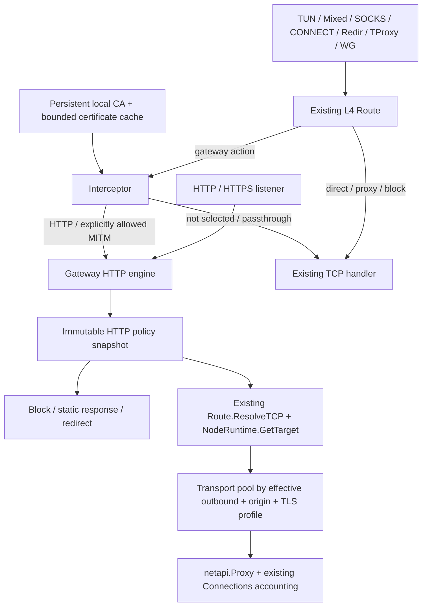

# HTTP Gateway architecture

The Gateway adds HTTP policy beside the existing L4 Route. It does not replace
Route, NodeRuntime, DNS/FakeIP, or the outbound protocol implementations.

`pkg/gateway/http.go` owns HTTP execution through `httputil.ReverseProxy`.
`policy.go` compiles boolean conditions and deterministic first-match ordering.
`transport.go` owns reusable transports; `upstream.go` and `health.go` own backend
selection, admission limits, health probes, and retry policy. `interceptor.go`
admits selected inbound TCP streams and replays probes without losing bytes.
`authority.go` owns CA management; shared issuance/cache primitives live in
`pkg/cert`. `manager.go` prepares and publishes snapshots; `listener.go` owns
listening sockets and their access boundary.

Each request forks `netapi.Context`. Original destination, HTTP authority,
rewritten backend address, and effective outbound remain distinct. Concurrent
HTTP/2 streams do not mutate connection-level routing state. Selection happens
before transport lookup, even if a connection is already reusable. Selector
updates resolve the current node on the next request; old streams may finish on
their pinned transport. Family-restricting node wrappers expose their stable
parent/family pool identity rather than a newly allocated wrapper address.

Pool keys include effective proxy identity, resolved destination, origin, SNI,
trust material, connect/idle/request timeout, and maximum connections. Pools have 256 entries per Gateway. Retiring
an entry closes idle connections; active responses retain ownership until body
completion/close. Config replacement drains old pools without buffering bodies.

The common inbound TCP path has one optional hook into the existing Route.
An explicit Gateway rule action is required before Gateway admission runs. With
no Gateway rules, the hook returns before readers or routing work. Known target
domains are checked before probing, and an ordinary routing result is reused
for its connection dial; each HTTP request still resolves its outbound afresh.
UDP is unchanged, including QUIC. Process lookup is requested only for selected
settings/policies that use process conditions and respects global lookup-off.

SQLite migration 12 adds `gateway_configuration`, `gateway_references`, and
`gateway_ca`. Preparing policies/listeners happens before persistence. Config and
external references commit together; one atomic swap then activates the prepared
snapshot. Failed compilation, bind, revision, or persistence leaves the previous
snapshot running. Existing listener addresses are reused. Disabled/deleted
listeners and interception sessions close; surviving connections use the current
HTTP policy for subsequent requests. Already executing requests retain their
snapshot safely.

`reverse_http` and the `http_termination` outbound have been removed. Configure
HTTP reverse proxying, policies and header rewriting directly in Gateway.
`reverse_tcp` remains as a small inbound-owned TCP stream adapter; the old
`pkg/net/proxy/reverse` package is gone. TLS Auto shares certificate issuance/cache
code but keeps its own CA and
domain policy. Enabling TLS Auto never enables MITM.

See [configuration](configuration.md), [interception](interception.md),
[CA management](certificate-authority.md), and [benchmarks](benchmarks.md).

See [Route handoff and avoided work](route-handoff.md).
