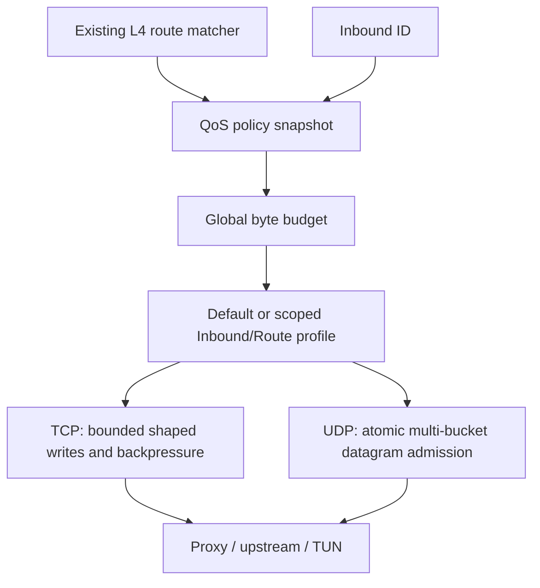

# Traffic Control: P1/P2 implementation notes

This document accompanies stacked implementation PR **#584**, based on **#583**, tracking RFC **#582**.

## Scope

P1 includes byte-based DRR, CoDel-style active queue management in the independent lightweight TUN stack, and bounded weighted service for internally generated TCP control/ICMP packets. The priority weight is clamped (1–4); it is **not** a strict priority queue. Ordinary flows remain eligible for service even under control-plane traffic. DSCP and destination port 53 are not automatically trusted for priority.

P2 adds optional hierarchical application-payload shaping to inbound TCP relay streams and UDP NAT traffic. The default installation is **unlimited** until a validated configuration is saved and enabled.



## Configuration and RPC

The application exposes `POST /api/v2/rpc/traffic_control.get` and `POST /api/v2/rpc/traffic_control.put` through the existing v2 JSON-RPC compatibility layer. Their underlying route patterns are `GET /api/v2/traffic-control` and `PUT /api/v2/traffic-control` respectively, but the v2 handler framework maps these to POST RPC endpoints.

A PUT body can look like:

```json
{
  "enabled": true,
  "global": {
    "upload": {"bytesPerSecond": 12500000, "burstBytes": 65536},
    "download": {"bytesPerSecond": 12500000, "burstBytes": 65536}
  },
  "defaultProfile": "balanced",
  "profiles": {
    "balanced": {"upload": {"bytesPerSecond": 0}, "download": {"bytesPerSecond": 0}},
    "bulk": {"upload": {"bytesPerSecond": 1250000}, "download": {"bytesPerSecond": 1250000}}
  },
  "inboundProfiles": {"inbound-id": "bulk"},
  "routeProfiles": {"route-rule-id": "bulk"}
}
```

**Units are bytes per second, not bits per second.** 12,500,000 bytes/s is 100 Mbit/s before protocol encapsulation, retransmission, and IP/header overhead. A zero rate with zero burst is unlimited. If a positive rate omits burst, a 64 KiB burst is assigned so even a large UDP datagram can be admitted at low rates; an explicitly smaller burst can intentionally prevent larger datagrams.

Global constraints always apply. The default profile is an aggregate fallback only where no explicit Inbound or Route binding matches. When both bindings exist, their rate limits compose: the same packet/stream must satisfy global, Inbound, and Route scopes. Two unrelated inbound IDs using the same profile definition get independent scoped buckets; this avoids unexpected cross-tenant sharing.

The persistence owner is `pkg/store.InboundStore` backed by SQLite; `pkg/inbound.ContractStore` applies a validated snapshot after the durable save. Invalid references or rates do not replace the active configuration. New TCP streams capture the policy when their outbound route is selected, while UDP packets resolve the current snapshot for each datagram.

## Transport behavior

- **TCP:** existing bidirectional relay semantics, optional bounded shaping at the writer, automatic backpressure through the copy loop, and cancellation that interrupts both blocked directions. No packet-per-goroutine scheduler is introduced.
- **UDP:** immediate all-or-nothing non-blocking token admission before remote send and before inbound reply write. No delayed-datagram queue is introduced; over-limit packets count as drops.
- **Lightweight TUN output:** FQ-CoDel and byte DRR remain independent from TCP congestion control (Reno/CUBIC/BBR). Internally generated TCP control packets are assigned bounded extra service share; client-supplied DSCP is ignored.
- **Runtime changes:** compiled config snapshots activate atomically. Existing TCP sessions retain their original profile and reservations until disconnect; subsequent UDP packets use the new snapshot. This transition behavior is deliberate and should be accounted for when changing aggregate caps in production.

## Limits of this iteration

This branch does **not** claim full enterprise QoS. Raw TUN device-level traffic shaping across every stack and physical outbound, precise per-route UDP policy matching after asynchronous routing, per-user/device hierarchical fairness, trusted priority classes for arbitrary application flows, UI integration, and cross-platform native mixed-load qualification remain follow-ups. Rate limiting after network ingress cannot undo bytes already transferred over the public WAN.

## Verification

The dedicated CI runs Go race tests for trafficcontrol, relay, NAT, inbound, store, HTTP API, and the lightweight stack, alongside benchmark smoke and golangci-lint. Representative scenarios include stream cancellation, UDP byte budgets, active-session quotas, fairness under load, IPv6 extension headers, token-bucket burst behavior, invalid policy publication, and SQLite round-trip.

Benchmark figures from `-benchtime=100x` are **smoke measurements** and must not be interpreted as statistically reliable real-network throughput or latency results. Production acceptance additionally needs sustained mixed TCP/UDP benchmarks, CPU/PPS overload, native TUN/utun/Android VpnService, and traffic-shaping overhead baselines.
