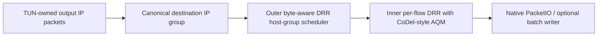

# Traffic Control P3: host fairness, diagnostics and management

This is the P3 child implementation [#585](https://github.com/yuhaiin/yuhaiin/pull/585) stacked on the P1/P2 child [#584](https://github.com/yuhaiin/yuhaiin/pull/584) and the P0/P1 child [#583](https://github.com/yuhaiin/yuhaiin/pull/583). RFC [#582](https://github.com/yuhaiin/yuhaiin/pull/582).

## Host isolation (Lightweight TUN output)

A single TUN-attached device opening a hundred connections should not be able to multiply its outer scheduling share a hundredfold.

- **Outer group:** destination IP address on packets written to the TUN device. IPv4/IPv6 families are separated. The host identifier is hashed, not exported as a metric label. Collisions share a group. This is *endpoint grouping*, not a cryptographically authenticated identity; behind CGNAT, multiple real devices may share a group.
- **Inner group:** network-flow hash with byte-aware DRR, bounded control-message weights and CoDel-style queue-delay management.
- **Hard budget:** total owned output packets and packet bytes are enforced across every group, not multiplied by the number of groups. Dropped or drained packets must be released exactly once outside queue locks.
- **Fallback:** undecodable/non-IP buffers are assigned to a single fallback group; parser failures cannot create arbitrary high-cardinality groups.
- **Scope:** the current grouping is on the lightweight stack's *output* queue. It does not make claims about the default gVisor/TUN2Socket stacks, packet ingress CPU fairness, or physical WAN uplink scheduling.

The deterministic test `TestGroupedFairQueueHostIsolationFromFlowMultiplication` compares 120 concurrent flows from one group with a single flow from another. It checks the group-level packet progress rather than a misleading ungrouped per-flow Jain index.

## Diagnostics API

The existing P2 QoS configuration API remains:

- `POST /api/v2/rpc/traffic_control.get`
- `POST /api/v2/rpc/traffic_control.put`

P3 adds `POST /api/v2/rpc/traffic_control.status` (legacy v2 pattern `GET /api/v2/traffic-control/status`). The status snapshot reports the global Resource Governor, UDP NAT resource governor and a bounded first 64 inbound governor scopes. It exposes active sessions, reserved queued bytes, pending tasks and denial counters by admission reason. If there are more inbound scopes than can safely be exposed, `truncated` is set.

The status also includes `shaping` counters: admitted upload/download **payload bytes**, rejected upload/download UDP datagrams, and accumulated TCP pacing wait nanoseconds. These are aggregated admitted workloads, not physical-wire bytes or a billing meter; a downstream transport may subsequently fail after admission.

The diagnostics are **aggregate resource accounting**, not a WAN throughput monitor or user-level billing. In particular, queued bytes represent explicitly charged allocations, not the entire process RSS. No remote IP, process name, destination, or user-supplied flow ID is emitted as a dynamic metric label.

## Frontend

The companion [yuhaiin-react UI PR #504](https://github.com/yuhaiin/yuhaiin-react/pull/504) provides one Traffic Control workspace with global upload/download shaping, reusable profiles, route/inbound bindings, settings persistence, and resource diagnostics. The frontend includes English, Japanese and Korean translations, validation, read-only statistics and an unsaved-changes guard. It uses the existing component design system and color palette.

## Deployment and troubleshooting

1. Start with shaping **disabled** (the default). The lightweight TUN fair scheduler and P0 resource budgets can still operate.
2. If enabling shaping, note that Mbps is decimal megabits per second, while the saved API uses **bytes per second** at the relay/UDP payload boundary. TCP/UDP payload shaping does not account for additional encapsulation and retransmission overhead.
3. Set a small positive burst for smooth pacing. When the stored burst is zero with a positive rate, the P2 shaper chooses a 64 KiB default. A specifically tiny burst can intentionally reject a UDP datagram larger than the bucket.
4. If a device appears starved, compare global vs. NAT denial counters and queue bytes first; rate limiting, session admission, memory pressure and CoDel drops are different problems.
5. If interactive traffic still stalls when saturated, identify the **actual** bottleneck before adjusting QoS: physical outbound, inbound TUN read CPU, tunnel congestion, or downstream TUN write queues can be distinct contention domains.

## Remaining acceptance gaps

P3 does **not** automatically close every item in the original RFC. Before enterprise-wide QoS can be called complete, separately verify:

- authenticated peer/user/device identity fair-share enforcement across VPN protocols;
- native TUN paths (Linux, Darwin, Android), default gVisor/TUN2Socket, GSO/batch correctness;
- real mixed TCP/QUIC/DNS under load, including CPU/PPS starvation and p95/p99 interactive latency;
- physical interface bottleneck shaping, non-duplicated rate charging and downlink caveats;
- adaptive shaper behavior after RTT/bandwidth changes (CAKE-inspired methods remain optional).

The P3 branch provides a concrete design and tests for host isolation, configuration management and resource diagnostics. It is **not** full CAKE, a universal BPF network shaper, or a fully authenticated per-user QoS implementation.
