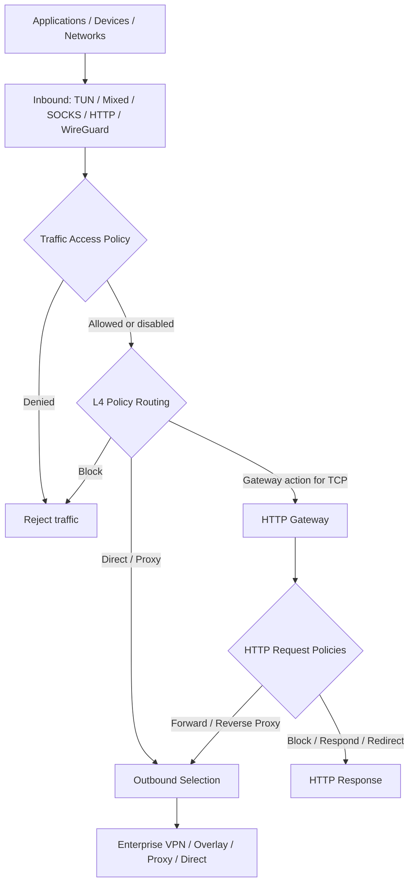

<p align="center">
  
</p>

<h1 align="center">Yuhaiin</h1>

<p align="center">
  <strong>Unified Network Security & Connectivity Toolkit</strong><br />
  Zero Trust-ready networking · Traffic policies · Enterprise VPN · HTTP Gateway · Modern proxy
</p>

<p align="center">
  <a href="https://github.com/Asutorufa/yuhaiin/releases"></a>
  <a href="https://github.com/Asutorufa/yuhaiin/actions/workflows/go.yml"></a>
  <a href="https://github.com/Asutorufa/yuhaiin/blob/main/LICENSE"></a>
  <a href="https://pkg.go.dev/github.com/Asutorufa/yuhaiin"></a>
</p>

**One engine. Many networks. Consistent traffic policies.**

Yuhaiin is an open-source, cross-platform networking toolkit bringing enterprise VPN connectivity, encrypted overlays, identity-aware traffic access, policy routing, traffic control and HTTP application gateways into one extensible engine. It also offers per-user resource governance, intelligent outbound selection, managed certificates and recovery tools for shared deployments.

> **Scope:** Yuhaiin provides building blocks for Zero Trust-style network access. It is **not** a complete ZTNA platform, identity provider, endpoint security product, or host-wide firewall.

## Why Yuhaiin?

- **Connect across network boundaries.** Use enterprise VPN clients, mesh/overlay networks, and modern proxies within one application.
- **Enforce traffic decisions centrally within the process.** Route, proxy, or block connections based on destinations, applications/processes, inbound sources, and rule priority.
- **Handle application traffic with HTTP Gateway.** Apply request-level policies, reverse proxy to backends, and choose existing outbound nodes per request.
- **Keep networking flexible.** Use a single lightweight userspace TCP/IP stack for TUN and VPN/overlay packet processing, without alternative gVisor or tun2socket TUN backends.
- **Control congestion and resource use.** Apply optional upload/download rate profiles, bound connection and NAT resources, and choose FIFO or fair output scheduling for the lightweight TUN stack.
- **Manage identities and trace proxy usage.** Use local accounts, custom roles, scoped tokens, Passkeys and optional OIDC; authenticate supported proxy inbounds with revocable per-device credentials, and inspect user traffic and security audits.
- **Enforce optional access and resource policy.** Manage user groups, explicit traffic allow/deny rules, identity-based bandwidth and byte quotas, and admission limits without conflating routing with authorization.
- **Operate resiliently.** Select healthy outbounds using latency/throughput/failover policies, back up deployment state in encrypted archives, and manage TLS certificates with ACME.

## Core Capabilities

| Capability | Highlights |
| --- | --- |
| **Traffic Security & Policy Routing** | L4 allow/route/block decisions; domain, IP, port, process, and inbound-based rules; DNS and FakeIP integration |
| **Management Identity & API Security** | Local and custom RBAC roles, scoped API tokens, revocable sessions, WebAuthn Passkeys, GitHub/Google OAuth, generic OIDC, management security audit |
| **Proxy User Authentication & Credentials** | Independently revocable device credentials for HTTP, SOCKS5, Mixed, Hysteria 2, Yuubinsya and SSTP inbounds; explicit legacy/users/mixed modes; shared outbound credential references |
| **Per-user Usage & Session Audits** | Lifetime and UTC-period traffic reports, credential/inbound/node/protocol breakdowns, rates and concurrency, filterable connection metadata audits, configurable retention |
| **Traffic Identity & Access Policy** | Stable user groups, identity-aware routing, separately enforced ordered allow/deny access policies, protected inbound scopes, deny-by-default options |
| **Identity Resource Governance** | User, group, shared-group and credential shaping, UTC-window byte quotas, sessions, connection/packet rate admission, diagnostics and bounded alerts |
| **Traffic Control & QoS** | Optional hierarchical upload/download limits with burst allowances; global/inbound/route profiles; connection and NAT resource budgets; lightweight TUN FIFO or FQ-CoDel scheduling; diagnostics |
| **Enterprise VPN & Overlay Networking** | Corporate SSL/IPsec VPN clients, WireGuard, Tailscale, Nebula, ZeroTier, and related encrypted networking protocols |
| **HTTP Gateway & Application Proxy** | HTTP/HTTPS reverse proxy, Host/Path/Header conditions, rewrites, redirects, URL filtering, upstream health checks and balancing, optional TLS interception |
| **Unified Proxy Engine** | TCP/UDP handling, transparent proxy, proxy chains, selectable outbounds, connection visibility, cross-platform clients |
| **Automatic Outbound Selection** | Manual, failover, fresh latency, measured throughput, balanced scoring and weighted new-flow distribution; bounded probing and circuit recovery |
| **Recovery & Managed Certificates** | Encrypted complete backups, verified local/S3 restore, protected updates and rollback, ACME HTTP-01 / Cloudflare DNS-01 with automated renewal |

### How traffic flows



The Traffic Access Policy is **optional** and acts before the ordinary L4 forwarding decision where enabled. Protected scopes require valid authenticated traffic identities. The HTTP Gateway is **optional**: ordinary connections continue through L4 routing without HTTP inspection. HTTPS interception is opt-in and requires an explicitly configured CA, target allowlist, and client trust. GREASE ECH can be inspected as ordinary TLS; real ECH inner traffic and HTTP/3 are not decrypted. The Gateway does not bypass certificate pinning.

## Supported Connectivity

| Category | Protocols and integrations |
| --- | --- |
| **Enterprise VPN clients** | OpenVPN, GlobalProtect, AnyConnect, Fortinet SSL VPN, IKEv2/IPsec, SSTP, SoftEther |
| **Mesh & overlay networking** | WireGuard, AmneziaWG, Tailscale (tsnet), Nebula, ZeroTier, Cloudflare WARP |
| **Modern proxies & tunnels** | Shadowsocks, ShadowsocksR, VMess, VLESS, Trojan, Hysteria 2, standard MASQUE CONNECT-IP client, SSH |
| **Standard proxy & ingress** | SOCKS4a/5, HTTP, Mixed, TUN, Redir, TProxy, WireGuard inbound, MASQUE HTTP/3 CONNECT-IP inbound, authenticated SSTP server (IPv4) |
| **Additional inbounds** | Experimental Linux SSH shell/exec with isolated per-connection networking; Krunlet microVM TCP/UDP over a local Unix socket |
| **DNS transports** | Classic DNS over UDP/TCP, DoT, DoH, DoQ, FakeDNS |

**MASQUE:** standard CONNECT-IP outbound supports HTTP/3 and HTTP/2; the bearer-token-protected server currently supports HTTP/3 only. See [the MASQUE guide](docs/masque.md) for setup and limitations.

**SSTP server:** rootless TLS/PPP/MS-CHAPv2 termination uses existing per-user device credentials and the lightweight stack without a host TUN/TAP device or route changes. It supports IPv4 only, stores password-equivalent NT-hash verifier material and needs a newly issued/rotated credential to support SSTP.

**Tailnet:** Tailscale connectivity uses the proven embedded `tsnet.Server` integration with Yuhaiin's configured outbound as its per-node network Underlay. TCP/UDP application traffic still runs through the shared lightweight userspace stack rather than an OS TUN. The previous `tailscaled.state` identity is reused when available; a node created only with `tailscale-lite` may need explicit enrollment or state recovery. See [Tailnet compatibility and rollback](docs/tailscale-rollback.md). The optional [`tailscale-lite` outbound](docs/tailscale-lite.md) uses a separate client and identity alongside `tailscale`.

**Support varies by protocol and platform.** The Linux-only SSH inbound is experimental and its network namespace does not provide filesystem or process isolation. The Krunlet inbound is a local Unix-socket integration, not a remote proxy listener. Some integrations have restricted transport/authentication modes. Nebula and ZeroTier are userspace outbound integrations, not general-purpose virtual Ethernet adapters. Check the linked implementation guides for supported features, packaging requirements, and limitations.

## Identity, Credentials & Auditing

Yuhaiin separates **management identities** (who can administer the service) from **proxy traffic credentials** (who can connect through supported inbounds). These credentials cannot be used interchangeably. Server-side identity management is optional for embedded/core-only integrations and is not installed by the native Android client.

### Management users and API access

- **Local accounts and permissions.** An administrator can create, disable, and reset accounts. Built-in `admin`, `read-only`, and `none` (proxy-only) roles coexist with named custom RBAC roles. Management APIs, log/event streams, metrics, and profiler endpoints are permission-checked when the server identity module is enabled.
- **Scoped tokens and sessions.** Issue revocable, permission-scoped API tokens for automation. Browser login uses HttpOnly session cookies; users can inspect and revoke their own sessions, including sessions created on another device.
- **Optional federated sign-in.** Sign in with GitHub/Google OAuth or configured generic HTTPS OpenID Connect providers (Authorization Code with PKCE). Providers are explicitly linked to existing local identities; email addresses or IdP role claims do not automatically grant permissions. SAML and SCIM/directory provisioning are not supported.
- **Passkeys.** Register and revoke WebAuthn Passkeys for management sign-in on trusted HTTPS DNS origins or local `http://localhost`, using the appropriate separate relying-party identity. Password and OAuth sign-in remain available.
- **Password handling.** The browser derives a client credential with PBKDF2; the server applies Argon2id before storing its verifier. The derived credential is still reusable if captured, so remote management **requires trusted HTTPS**.

### Authenticated proxy users and shared secrets

- **Per-device credentials.** Users can create, rotate, expire, revoke, and delete independently named proxy credentials (up to 64 active credentials per user), scoped to selected inbounds and/or protocols. Administrators can manage other users' credentials. SSTP requires a newly issued or rotated credential carrying an MS-CHAPv2-compatible verifier.
- **Supported authenticated inbounds.** HTTP, SOCKS5, Mixed, Hysteria 2, Yuubinsya, and SSTP support user credentials. SOCKS4, WireGuard, SSH shell sessions and transparent inbounds do not automatically receive these identities. Authenticated SOCKS5 UDP uses a relay associated with its authenticated TCP session.
- **Explicit authentication modes.** `legacy` accepts existing shared credentials as unattributed traffic; `users` accepts only selected device credentials; `mixed` deliberately accepts both. Older configurations retain their original authentication behavior. Revoking a user does not revoke a shared password, but protected traffic access scopes reject unauthenticated or legacy-shared identities.
- **Shared outbound credentials.** Supported outbound layers can reference centrally managed upstream secrets rather than embedding the same password in multiple node configurations. These secrets are distinct from local user credentials.

For setup details, supported protocols, authentication behavior, and storage limitations, see [management authentication](docs/MANAGEMENT_AUTH.md) and [proxy and upstream credentials](docs/proxy-credentials.md).

### User traffic reports and connection audits

The **Account & Security** workspace includes user traffic reports and connection audit history:

- Upload/download payload bytes for lifetime or selected UTC periods, with hourly, daily, and monthly trends.
- Per-user, credential, inbound, outbound node, and TCP/UDP breakdowns; sampled rates, active minutes, session duration, and current/peak concurrency.
- Filterable, cursor-paginated session metadata, including source, destination, selected route/node, timestamps, transferred bytes, and connection outcome.
- Permission-scoped visibility: users can inspect their own activity; authorized operators can inspect other users or unattributed traffic. Administrators can configure retention (completed audits default to 30 days).

Statistics are sampled asynchronously and persisted to SQLite. They measure proxy payload bytes, **not** physical WAN usage. Connection audits omit payload content and authentication secrets, but can lose checkpoints during overload or crashes; they are not a lossless compliance or billing ledger. Identity-aware access policies, per-user/group limits, and traffic quotas are implemented as opt-in features described below; quota measurements remain conservative application-byte accounting, not billing-grade wire accounting.

See [user traffic statistics and audit](docs/user-usage.md) for accuracy, attribution, retention, and recovery behavior.

### Traffic groups, access policies, and quotas

- **Traffic groups.** Manage stable group memberships and use user, group, and credential matches in L4 routing and its match traces. Routing rules still determine forwarding, **not authorization**.
- **Explicit authorization.** Enable ordered allow/deny Traffic Access Policies with a default action and selected protected inbounds. A protected flow requires an authenticated user/credential identity; anonymous or legacy-shared traffic and unsupported identities fail closed. Inbounds excluded from the policy scope remain outside that gate.
- **Identity resource policies.** Compose user profiles and overrides, individual and shared aggregate group limits, and credential limits with existing global/inbound/route Traffic Control. Supported budgets include up/down rates, UTC-window byte quotas, concurrent sessions and connection/packet admission rates.
- **Revocation and visibility.** Changed identity memberships revoke affected traffic; revision-checked activation and bounded diagnostics expose quota utilization, rejections, and alerts.

See [traffic groups](docs/enterprise-identity.md), [traffic access policy](docs/traffic-access.md), and [resource governance](docs/resource-governance.md).

### Enterprise management security

- **Custom roles.** Built-in roles remain protected; custom permission assignments extend management access. API tokens are always intersected with their owner's current permissions. Management roles and traffic groups are independent.
- **Security event auditing.** Management mutations have a separate transactional local audit ledger with searchable, permission-filtered export, configurable retention, and optional bounded remote forwarding. These events differ from the lossy connection metadata audit.
- **Secret-aware configuration changes.** Sensitive values are redacted by default, and retaining/replacing them requires explicit authorization. Revision-checked staged single-resource changes support validation, diffs, history and rollback-to-draft, not cross-database atomic rollback.

See [custom roles](docs/management-roles.md), [OIDC](docs/oidc.md), [management audits](docs/security-audit.md), [secret handling](docs/secret-isolation.md), and [configuration changes](docs/configuration-changes.md).

## Traffic Control & QoS

Traffic control shares one policy and resource-governor implementation across inbound streams, ordinary TCP relays, HTTP Gateway interception, and NAT/UDP paths. Configure it in the web UI or through the `traffic_control.get`, `traffic_control.put`, and `traffic_control.status` RPC endpoints.

- **Bandwidth profiles.** Set independent upload/download limits for the global engine, individual inbounds, and selected L4 route rules. Applicable limits compose, and profiles use token buckets with configurable burst capacity. The UI displays decimal Mbps; the API stores bytes per second.
- **Connection and NAT protection.** Bound concurrent sessions and queued resources to reduce the impact of overload. TCP stream shaping applies backpressure, while UDP packets exceeding their admission limit are dropped rather than delayed.
- **Authenticated identity governance.** Per-user, credential, and shared-group budgets add admission and shaping constraints without weakening global/inbound/route limits.
- **Lightweight TUN scheduling.** Choose `fifo` (default) or explicitly select `fq_codel` using `outputScheduler`. FQ-CoDel groups traffic by destination host and flow, using deficit round-robin fairness and active queue management to reduce domination by backlogged flows. This selector applies to the **lightweight** stack, not gVisor, TUN2Socket, or the physical WAN interface.
- **Persistence and diagnostics.** Policy is persisted in SQLite and activated atomically. Status reports bounded global, NAT, inbound-scope, and supported output-queue counters, including admission rejection and queue drops.

**Defaults and limits:** Bandwidth shaping is **disabled by default**, while resource admission budgets and lightweight output scheduling remain available. Enabling shaping does **not** automatically enable FQ-CoDel. Limits account for admitted client-facing bytes and UDP payloads, not physical-wire bytes or tunneling/retransmission overhead. Host-based fairness does not identify authenticated users.

See the [traffic-control architecture and configuration](docs/traffic-control/README.md) and [qualification and benchmark results](docs/traffic-control/benchmarks.md) for implementation details, overhead measurements, and remaining platform/latency validation limits.

## Operations & Reliability

### Intelligent outbound selection

Selectors support manual choice (the existing default), priority failover, fresh RTT, measured throughput, balanced scoring and weighted new-flow distribution. Candidate settings include priority and weight, independent TCP/UDP health evidence, circuit recovery, hold/cooldown, budgeted probes and explicit fallback. New flows use current selection decisions; established TCP/UDP flows are not silently moved or replayed. Observed application throughput is not a measured link capacity, and active speed tests use bounded, explicitly configured targets.

See [selector policies](docs/intelligent-selectors.md), [probe policies](docs/probe-policy.md), and [measurement limits](docs/measurement-bounds.md).

### Encrypted recovery and guarded updates

Full disaster recovery is distinct from sanitized configuration export. Coherent snapshots of owned databases and identities can be encrypted with age to externally held keys, scheduled to local/S3 storage, verified and restored through staged original-instance/clone workflows. Protected software updates verify package/schema compatibility, create recovery points and check actual startup. The updater retains the two previous executables; an older binary alone **cannot undo a database migration**.

Automatic disruptive recovery/update supervision is qualified for supported Linux systemd system and lingering user services. Other hosts require the documented offline procedures and have separate durability and privileges limits. Keep archive decryption keys and administrative credentials outside the deployment being protected.

See [backup and recovery](docs/backup-recovery.md), [encrypted archives](docs/recovery-archive.md), [managed backups](docs/managed-recovery-backups.md), and [update/rollback](docs/update-rollback.md).

### Managed HTTPS certificates

Site certificates support ACME HTTP-01 via an explicitly enabled port-80 Gateway and Cloudflare DNS-01, persisted renewal/backoff, certificate validation and hot replacement for new TLS handshakes. Management HTTPS can explicitly reference a managed certificate; Gateway termination can select a managed certificate resource. Site certificates remain separate from Gateway interception and private CAs, and existing file/self-signed TLS stays available.

See [managed certificates](docs/managed-certificates.md) and [enterprise reliability qualification](docs/enterprise-reliability-audit.md).

## Typical Use Cases

**Enterprise network access.** Connect to a corporate VPN endpoint while retaining application-aware routing, local DNS behavior, and rules for other traffic.

**Shared proxy gateway.** Give users separate proxy credentials, configure traffic groups and default-deny destination access, apply user/group quotas, and review attributed connection and management event history.

**Private service connectivity.** Reach resources through WireGuard, Tailscale, Nebula, or ZeroTier while using the same manual or health-based outbound selection as other proxies.

**Application gateway.** Expose an HTTP/HTTPS service, select backend pools and outbound paths, apply Host/Path/Header policies, and optionally block unwanted URLs.

**Transparent traffic control.** Send selected system or application connections through TUN/TProxy/Redir, enforce L4 policies, and optionally apply per-inbound or per-route bandwidth limits. On lightweight TUN, opt into FQ-CoDel for competing flows.

**Linux command and microVM egress.** Send experimental SSH shell/exec networking through a per-connection namespace or route local Krunlet microVM TCP/UDP through a protected Unix socket. The SSH feature is not a general-purpose security sandbox.

## Platforms

- **Linux**, **macOS**, and **Windows** for desktop and server-oriented deployment. The experimental SSH shell/exec inbound requires Linux namespace and TUN privileges.
- **Android** via the [Yuhaiin Android client](https://github.com/yuhaiin/yuhaiin-android).

Availability of specific inbound modes, native VPN libraries, and platform integrations differs across builds.

## Quick Start

Download a build from [GitHub Releases](https://github.com/Asutorufa/yuhaiin/releases), or build/install from source:

```bash
# Build from the repository
make yuhaiin

# Or install the Go command
go install github.com/Asutorufa/yuhaiin@latest

# macOS (Homebrew)
brew tap yuhaiin/yuhaiin
brew install yuhaiin
```

On macOS, manually downloaded unsigned binaries may require removing quarantine and an ad-hoc signature:

```bash
xattr -rd com.apple.quarantine yuhaiin
codesign -s - yuhaiin
```

Start the service:

```bash
yuhaiin -host="127.0.0.1:50051" -path="$HOME/.config/yuhaiin"
```

Open **http://127.0.0.1:50051** to configure your inbounds, nodes, routing policies, traffic control, and HTTP Gateway. On the first start of the server executable, find the **Initialization code** in the local startup output (valid for 15 minutes), then use **Create administrator** in the Web UI to enroll the first account. The code is not published through an unauthenticated HTTP endpoint.

For automation, supply a code through `YUHAIIN_INITIALIZATION_CODE` or `yuhaiin run -initialization-code` (CLI takes precedence). Supplied codes are hidden from startup output and only apply until initialization completes. See [the initialization-code format and restart behavior](docs/MANAGEMENT_AUTH.md#first-time-setup-and-migration).

After signing in, open **Account & Security** to manage users, traffic groups, custom roles, API tokens, OAuth/OIDC account links, Passkeys, browser sessions, proxy credentials, and security/audit reports. Configure identity resource policies under **Traffic Control**. To attribute proxy traffic to a user, create a device credential and explicitly authorize that user on a supported inbound. A management account alone does not enable proxy authentication on an inbound.

The management endpoint above is local by default. **Use HTTPS with a trusted certificate for remote management**; local loopback HTTP remains supported for development and local use.

> For a local proxy, configure or enable a **Mixed inbound** (commonly port **1080**). The HTTP management address (`50051`) is a separate service, not the proxy port.

## Screenshots

The current web UI:


## Documentation

- [HTTP Gateway architecture](docs/gateway/architecture.md) · [Configuration](docs/gateway/configuration.md) · [HTTPS interception](docs/gateway/interception.md)
- [Gateway reverse proxy](docs/gateway/reverse-proxy.md) · [Benchmarks](docs/gateway/benchmarks.md)
- [Management authentication](docs/MANAGEMENT_AUTH.md) · [Proxy and shared upstream credentials](docs/proxy-credentials.md) · [OIDC](docs/oidc.md)
- [User usage reports](docs/user-usage.md) · [Traffic groups](docs/enterprise-identity.md) · [Traffic access policies](docs/traffic-access.md) · [Resource governance](docs/resource-governance.md)
- [Traffic control](docs/traffic-control/README.md) · [Traffic-control benchmarks](docs/traffic-control/benchmarks.md) · [Intelligent selectors](docs/intelligent-selectors.md)
- [WireGuard inbound](docs/wireguard-inbound.md) · [Hysteria 2](docs/hysteria2.md) · [MASQUE](docs/masque.md) · [Linux SSH inbound](docs/ssh-session-inbound.md) · [Krunlet inbound](docs/krunlet-inbound.md)
- [OpenVPN](pkg/net/proxy/openvpn/README.md) · [GlobalProtect](pkg/net/proxy/globalprotect/README.md) · [Nebula](pkg/net/proxy/nebula/README.md) · [ZeroTier](pkg/net/proxy/zerotier/README.md)
- [Custom roles](docs/management-roles.md) · [Management audits](docs/security-audit.md) · [Secret isolation](docs/secret-isolation.md) · [Configuration changes](docs/configuration-changes.md)
- [Backup and recovery](docs/backup-recovery.md) · [Updates](docs/update-rollback.md) · [Managed certificates](docs/managed-certificates.md)
- [SSH outbound](pkg/net/proxy/ssh/README.md) · [Rules](https://github.com/yuhaiin/kitte) · [Android client](https://github.com/yuhaiin/yuhaiin-android)

## Security Boundaries

Yuhaiin enforces rules for traffic entering its configured inbounds; it does not automatically replace an operating system firewall, endpoint posture enforcement or physical-link shaping. Traffic Access Policy must be explicitly enabled and scoped, and excluded inbounds can continue through ordinary L4 routing. Protected scopes require valid authenticated user/device identities. Management RBAC and network traffic-group authorization are separate. Legacy and mixed shared passwords remain capable of unauthenticated-to-user proxy traffic outside protected scopes.

Application-payload quotas and usage reports are not billing-grade WAN byte accounting. Connection audits can lose records under overload, while remote management-event delivery has documented retry/deduplication limits. Remote management requires trusted HTTPS (local loopback HTTP is supported). Privileged operators must protect private storage: certain upstream/provider credentials are not encrypted at rest, despite redaction from routine settings responses. Passkeys and OIDC are supported, but SAML, SCIM provisioning, endpoint posture assessment, centralized Controller/Agent distribution, high availability, and compliance certification are not provided.

Gateway TLS interception is disabled by default and requires explicit CA trust and allowlisting; ECH and certificate pinning still limit inspection. The experimental Linux SSH inbound shares the host filesystem and process namespace and **must not be offered to untrusted shell users** without stronger isolation. SSTP relies on legacy MS-CHAPv2 and sensitive NT-hash verifier material. Review each protocol's security and platform restrictions.

## Community & Acknowledgements

Yuhaiin builds on the broader Go networking and open-source ecosystem, including [gVisor](https://github.com/google/gvisor), [Tailscale](https://github.com/tailscale/tailscale), and many protocol projects and contributors. See the repository history, dependencies, and individual integration documentation for attribution.

<details>
<summary>Acknowledgements and references</summary>

- [Go](https://go.dev/)
- [gVisor](https://github.com/google/gvisor)
- [プロ生ちゃん](https://kei.pronama.jp/)
- [Tailscale](https://github.com/tailscale/tailscale)
- [usque](https://github.com/Diniboy1123/usque)

References: [tun2socks](https://github.com/xjasonlyu/tun2socks), [shadowsocksR](https://github.com/mzz2017/shadowsocksR), [go-shadowsocks2](https://github.com/shadowsocks/go-shadowsocks2), and [vmess-client](https://github.com/gitsrc/vmess-client).

</details>

Contributions, bug reports, and reproducible interoperability tests are welcome.
