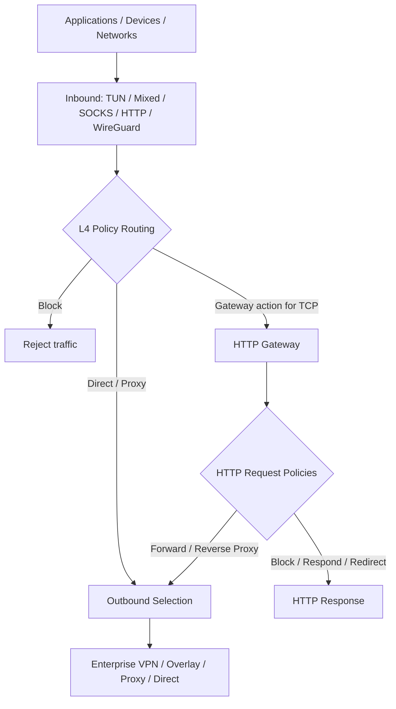

<p align="center">
  
</p>

<h1 align="center">Yuhaiin</h1>

<p align="center">
  <strong>Unified Network Security & Connectivity Toolkit</strong><br />
  Zero Trust-ready networking · Traffic policies · Enterprise VPN · HTTP Gateway · Modern proxy
</p>

<p align="center">
  <a href="https://github.com/Asutorufa/yuhaiin/releases"></a>
  <a href="https://github.com/Asutorufa/yuhaiin/actions/workflows/go.yml"></a>
  <a href="https://github.com/Asutorufa/yuhaiin/blob/main/LICENSE"></a>
  <a href="https://pkg.go.dev/github.com/Asutorufa/yuhaiin"></a>
</p>

**One engine. Many networks. Consistent traffic policies.**

Yuhaiin is an open-source, cross-platform networking toolkit that brings enterprise VPN connectivity, encrypted overlay networks, policy-based routing, traffic control, and HTTP application gateways into one extensible engine. Connect to different networks and services, control where traffic goes, and apply L4/L7 policies and optional bandwidth limits without maintaining a separate proxy stack for each protocol.

> **Scope:** Yuhaiin provides building blocks for Zero Trust-style network access. It is **not** a complete ZTNA platform, identity provider, endpoint security product, or host-wide firewall.

## Why Yuhaiin?

- **Connect across network boundaries.** Use enterprise VPN clients, mesh/overlay networks, and modern proxies within one application.
- **Enforce traffic decisions centrally within the process.** Route, proxy, or block connections based on destinations, applications/processes, inbound sources, and rule priority.
- **Handle application traffic with HTTP Gateway.** Apply request-level policies, reverse proxy to backends, and choose existing outbound nodes per request.
- **Keep networking flexible.** Use a single lightweight userspace TCP/IP stack for TUN and VPN/overlay packet processing, without alternative gVisor or tun2socket TUN backends.
- **Control congestion and resource use.** Apply optional upload/download rate profiles, bound connection and NAT resources, and choose FIFO or fair output scheduling for the lightweight TUN stack.
- **Manage identities and trace proxy usage.** Protect management APIs with local accounts and scoped tokens, authenticate supported proxy inbounds with per-user device credentials, and inspect user traffic reports and connection audits.

## Core Capabilities

| Capability | Highlights |
| --- | --- |
| **Traffic Security & Policy Routing** | L4 allow/route/block decisions; domain, IP, port, process, and inbound-based rules; DNS and FakeIP integration |
| **Management Identity & API Security** | Local administrator/read-only/proxy-only accounts, permission-scoped API tokens, revocable browser sessions, GitHub/Google OAuth sign-in and account linking |
| **Proxy User Authentication & Credentials** | Independently revocable credentials for supported HTTP, SOCKS5, Mixed, Hysteria 2, and Yuubinsya inbounds; optional per-inbound user selection; shared outbound credential references |
| **Per-user Usage & Session Audits** | Lifetime and UTC-period traffic reports, credential/inbound/node/protocol breakdowns, rates and concurrency, filterable connection metadata audits, configurable retention |
| **Traffic Control & QoS** | Optional hierarchical upload/download limits with burst allowances; global/inbound/route profiles; connection and NAT resource budgets; lightweight TUN FIFO or FQ-CoDel scheduling; diagnostics |
| **Enterprise VPN & Overlay Networking** | Corporate SSL/IPsec VPN clients, WireGuard, Tailscale, Nebula, ZeroTier, and related encrypted networking protocols |
| **HTTP Gateway & Application Proxy** | HTTP/HTTPS reverse proxy, Host/Path/Header conditions, rewrites, redirects, URL filtering, upstream health checks and balancing, optional TLS interception |
| **Unified Proxy Engine** | TCP/UDP handling, transparent proxy, proxy chains, selectable outbounds, connection visibility, cross-platform clients |

### How traffic flows



The HTTP Gateway is **optional**: ordinary connections continue through L4 routing without HTTP inspection. HTTPS interception is opt-in and requires an explicitly configured CA, target allowlist, and client trust. GREASE ECH can be inspected as ordinary TLS; real ECH inner traffic and HTTP/3 are not decrypted. The Gateway does not bypass certificate pinning.

## Supported Connectivity

| Category | Protocols and integrations |
| --- | --- |
| **Enterprise VPN clients** | OpenVPN, GlobalProtect, AnyConnect, Fortinet SSL VPN, IKEv2/IPsec, SSTP, SoftEther |
| **Mesh & overlay networking** | WireGuard, AmneziaWG, Tailscale (tsnet), Nebula, ZeroTier, Cloudflare WARP |
| **Modern proxies & tunnels** | Shadowsocks, ShadowsocksR, VMess, VLESS, Trojan, Hysteria 2, standard MASQUE CONNECT-IP client, SSH |
| **Standard proxy & ingress** | SOCKS4a/5, HTTP, Mixed, TUN, Redir, TProxy, WireGuard inbound, MASQUE HTTP/3 CONNECT-IP inbound |
| **DNS transports** | Classic DNS over UDP/TCP, DoT, DoH, DoQ, FakeDNS |

**MASQUE:** standard CONNECT-IP outbound supports HTTP/3 and HTTP/2; the authenticated server currently supports HTTP/3 only. See [the MASQUE guide](docs/masque.md) for setup and limitations.

**Tailnet:** Tailscale connectivity uses the proven embedded `tsnet.Server` integration with Yuhaiin's configured outbound as its per-node network Underlay. TCP/UDP application traffic still runs through the shared lightweight userspace stack rather than an OS TUN. The previous `tailscaled.state` identity is reused when available; a node created only with `tailscale-lite` may need explicit enrollment or state recovery. See [Tailnet compatibility and rollback](docs/tailscale-rollback.md).

**Support varies by protocol and platform.** Some integrations remain experimental or have restricted transport/authentication modes. Nebula and ZeroTier are userspace outbound integrations, not general-purpose virtual Ethernet adapters. Check the linked implementation guides for supported features, packaging requirements, and limitations.

## Identity, Credentials & Auditing

Yuhaiin separates **management identities** (who can administer the service) from **proxy traffic credentials** (who can connect through supported inbounds). These credentials cannot be used interchangeably. Server-side identity management is optional for embedded/core-only integrations and is not installed by the native Android client.

### Management users and API access

- **Local accounts and permissions.** An administrator can create, disable, and reset accounts. Built-in roles include `admin`, `read-only`, and `none` (a proxy-only user with credential self-service). Management API methods, log/event streams, metrics, and profiler endpoints are permission-checked when the server's identity module is enabled.
- **Scoped tokens and sessions.** Issue revocable, permission-scoped API tokens for automation. Browser login uses HttpOnly session cookies; users can inspect and revoke their own sessions, including sessions created on another device.
- **Optional OAuth.** Sign in with GitHub or Google and explicitly link/unlink providers to existing accounts. These integrations do not constitute a generic enterprise OIDC/SAML or directory provisioning solution.
- **Password handling.** The browser derives a client credential with PBKDF2; the server applies Argon2id before storing its verifier. The derived credential is still reusable if captured, so remote management **requires trusted HTTPS**.

### Authenticated proxy users and shared secrets

- **Per-device credentials.** Users can create, rotate, expire, revoke, and delete independently named proxy credentials (up to 64 active credentials per user), scoped to selected inbounds and/or protocols. Administrators can manage other users' credentials.
- **Supported authenticated inbounds.** HTTP, SOCKS5, Mixed, Hysteria 2, and Yuubinsya support user credentials. SOCKS4, WireGuard, transparent inbounds, and other protocols are not automatically covered. Authenticated SOCKS5 UDP uses a relay associated with its authenticated TCP session.
- **Existing configurations remain compatible.** User authentication is explicitly enabled per inbound. Existing shared protocol passwords may still authenticate alongside configured user credentials; these legacy connections are *not* attributed to a user, and revoking a user's credential cannot revoke the shared password.
- **Shared outbound credentials.** Supported outbound layers can reference centrally managed upstream secrets rather than embedding the same password in multiple node configurations. These secrets are distinct from local user credentials.

For setup details, supported protocols, authentication behavior, and storage limitations, see [management authentication](docs/MANAGEMENT_AUTH.md) and [proxy and upstream credentials](docs/proxy-credentials.md).

### User traffic reports and connection audits

The **Account & Security** workspace includes user traffic reports and connection audit history:

- Upload/download payload bytes for lifetime or selected UTC periods, with hourly, daily, and monthly trends.
- Per-user, credential, inbound, outbound node, and TCP/UDP breakdowns; sampled rates, active minutes, session duration, and current/peak concurrency.
- Filterable, cursor-paginated session metadata, including source, destination, selected route/node, timestamps, transferred bytes, and connection outcome.
- Permission-scoped visibility: users can inspect their own activity; authorized operators can inspect other users or unattributed traffic. Administrators can configure retention (completed audits default to 30 days).

Statistics are sampled asynchronously and persisted to SQLite. They measure proxy payload bytes, **not** physical WAN usage. Connection audits omit payload content and authentication secrets, but can lose checkpoints during overload or crashes; they are not a lossless compliance or billing ledger. **User/group-based access policies, per-user bandwidth limits, and traffic quotas are not yet implemented.**

See [user traffic statistics and audit](docs/user-usage.md) for accuracy, attribution, retention, and recovery behavior.

## Traffic Control & QoS

Traffic control shares one policy and resource-governor implementation across inbound streams, ordinary TCP relays, HTTP Gateway interception, and NAT/UDP paths. Configure it in the web UI or through the `traffic_control.get`, `traffic_control.put`, and `traffic_control.status` RPC endpoints.

- **Bandwidth profiles.** Set independent upload/download limits for the global engine, individual inbounds, and selected L4 route rules. Applicable limits compose, and profiles use token buckets with configurable burst capacity. The UI displays decimal Mbps; the API stores bytes per second.
- **Connection and NAT protection.** Bound concurrent sessions and queued resources to reduce the impact of overload. TCP stream shaping applies backpressure, while UDP packets exceeding their admission limit are dropped rather than delayed.
- **Lightweight TUN scheduling.** Choose `fifo` (default) or explicitly select `fq_codel` using `outputScheduler`. FQ-CoDel groups traffic by destination host and flow, using deficit round-robin fairness and active queue management to reduce domination by backlogged flows. This selector applies to the **lightweight** stack, not gVisor, TUN2Socket, or the physical WAN interface.
- **Persistence and diagnostics.** Policy is persisted in SQLite and activated atomically. Status reports bounded global, NAT, inbound-scope, and supported output-queue counters, including admission rejection and queue drops.

**Defaults and limits:** Bandwidth shaping is **disabled by default**, while resource admission budgets and lightweight output scheduling remain available. Enabling shaping does **not** automatically enable FQ-CoDel. Limits account for admitted client-facing bytes and UDP payloads, not physical-wire bytes or tunneling/retransmission overhead. Host-based fairness does not identify authenticated users.

See the [traffic-control architecture and configuration](docs/traffic-control/README.md) and [qualification and benchmark results](docs/traffic-control/benchmarks.md) for implementation details, overhead measurements, and remaining platform/latency validation limits.

## Typical Use Cases

**Enterprise network access.** Connect to a corporate VPN endpoint while retaining application-aware routing, local DNS behavior, and rules for other traffic.

**Shared proxy gateway.** Give users separate proxy credentials for their devices, revoke access without rotating everyone's credentials, and review attributed connection history.

**Private service connectivity.** Reach resources through WireGuard or an overlay network such as Tailscale, Nebula, or ZeroTier, using the same outbound selection model as other proxies.

**Application gateway.** Expose an HTTP/HTTPS service, select backend pools and outbound paths, apply Host/Path/Header policies, and optionally block unwanted URLs.

**Transparent traffic control.** Send selected system or application connections through TUN/TProxy/Redir, enforce L4 policies, and optionally apply per-inbound or per-route bandwidth limits. On lightweight TUN, opt into FQ-CoDel when competing flows need fairer output scheduling.

## Platforms

- **Linux**, **macOS**, and **Windows** for desktop and server-oriented deployment.
- **Android** via the [Yuhaiin Android client](https://github.com/yuhaiin/yuhaiin-android).

Availability of specific inbound modes, native VPN libraries, and platform integrations differs across builds.

## Quick Start

Download a build from [GitHub Releases](https://github.com/Asutorufa/yuhaiin/releases), or build/install from source:

```bash
# Build from the repository
make yuhaiin

# Or install the Go command
go install github.com/Asutorufa/yuhaiin@latest

# macOS (Homebrew)
brew tap yuhaiin/yuhaiin
brew install yuhaiin
```

On macOS, manually downloaded unsigned binaries may require removing quarantine and an ad-hoc signature:

```bash
xattr -rd com.apple.quarantine yuhaiin
codesign -s - yuhaiin
```

Start the service:

```bash
yuhaiin -host="127.0.0.1:50051" -path="$HOME/.config/yuhaiin"
```

Open **http://127.0.0.1:50051** to configure your inbounds, nodes, routing policies, traffic control, and HTTP Gateway. On the first start of the server executable, find the **Initialization code** in the local startup output (valid for 15 minutes), then use **Create administrator** in the Web UI to enroll the first account. The code is not published through an unauthenticated HTTP endpoint.

After signing in, open **Account & Security** to manage users, API tokens, linked OAuth accounts, active sessions, proxy credentials, and user traffic/audit reports. To attribute proxy traffic to a user, create a device credential and explicitly authorize that user on a supported inbound. A management account alone does not enable proxy authentication on an inbound.

The management endpoint above is local by default. **Use HTTPS with a trusted certificate for remote management**; local loopback HTTP remains supported for development and local use.

> For a local proxy, configure or enable a **Mixed inbound** (commonly port **1080**). The HTTP management address (`50051`) is a separate service, not the proxy port.

## Screenshots

The current web UI:


## Documentation

- [HTTP Gateway architecture](docs/gateway/architecture.md) · [Configuration](docs/gateway/configuration.md) · [HTTPS interception](docs/gateway/interception.md)
- [Gateway reverse proxy](docs/gateway/reverse-proxy.md) · [Benchmarks](docs/gateway/benchmarks.md)
- [Management authentication & account setup](docs/MANAGEMENT_AUTH.md) · [Proxy/user credentials & shared upstream secrets](docs/proxy-credentials.md)
- [User traffic reports & audits](docs/user-usage.md) · [User usage benchmarks](docs/benchmarks/user-usage.md)
- [Traffic control](docs/traffic-control/README.md) · [Traffic-control benchmarks](docs/traffic-control/benchmarks.md)
- [WireGuard inbound](docs/wireguard-inbound.md) · [Hysteria 2](docs/hysteria2.md)
- [OpenVPN](pkg/net/proxy/openvpn/README.md) · [GlobalProtect](pkg/net/proxy/globalprotect/README.md) · [Nebula](pkg/net/proxy/nebula/README.md) · [ZeroTier](pkg/net/proxy/zerotier/README.md)
- [SSH outbound](pkg/net/proxy/ssh/README.md) · [Rules](https://github.com/yuhaiin/kitte) · [Android client](https://github.com/yuhaiin/yuhaiin-android)

## Security Boundaries

Yuhaiin's routing rules and traffic-control limits apply to traffic entering its configured inbounds; they do not automatically replace the operating system's firewall or guarantee physical-link shaping. The current management roles and API permissions are **not** user/group-based authorization for network destinations. Some legacy shared inbound credentials remain accepted even when user credentials are configured and their traffic is unattributed. Remote management requires HTTPS, and upstream credentials in the private management database are **not encrypted at rest**. Gateway TLS interception is disabled by default and requires explicit configuration and client trust. Enterprise VPN support refers to interoperability with supported protocols; GitHub/Google OAuth is available, but generic enterprise SSO (OIDC/SAML), SCIM, device posture assessment, centralized policy distribution, high availability, and compliance certification are not provided.

## Community & Acknowledgements

Yuhaiin builds on the broader Go networking and open-source ecosystem, including [gVisor](https://github.com/google/gvisor), [Tailscale](https://github.com/tailscale/tailscale), and many protocol projects and contributors. See the repository history, dependencies, and individual integration documentation for attribution.

<details>
<summary>Acknowledgements and references</summary>

- [Go](https://go.dev/)
- [gVisor](https://github.com/google/gvisor)
- [プロ生ちゃん](https://kei.pronama.jp/)
- [Tailscale](https://github.com/tailscale/tailscale)
- [usque](https://github.com/Diniboy1123/usque)

References: [tun2socks](https://github.com/xjasonlyu/tun2socks), [shadowsocksR](https://github.com/mzz2017/shadowsocksR), [go-shadowsocks2](https://github.com/shadowsocks/go-shadowsocks2), and [vmess-client](https://github.com/gitsrc/vmess-client).

</details>

Contributions, bug reports, and reproducible interoperability tests are welcome.

### Intelligent outbound selectors

Opt-in selectors support priority failover, fresh RTT, measured download speed,
normalized balanced scoring, and weighted new connections. Manual selection
remains the compatibility default. The management UI exposes candidate evidence,
thresholds, manual lock, bounded manual download tests, and explicit preferred-node recovery. Metric-mode return must still clear ranking and switching thresholds. See the
[intelligent selector guide](docs/intelligent-selectors.md) for configuration,
measurement limits, migrations, and the remaining reliability rollout work.

The monitoring follow-up adds shared scheduled TCP/HTTPS/DNS/STUN checks,
conservative mobile/metered-network defaults, and optional periodic download
tests using the same bounded implementation and durable traffic budget.

The circuit follow-up adds independent TCP/UDP Closed/Open/Half-open admission,
finite recovery quotas, visible evidence and reasons, and protection against
stale measurements after transport/credential changes. Existing manual choices
and established sessions retain their semantics.

Application probes and active download tests share existing routing and traffic
controls, with startup readiness and bounded connection cleanup. See the
[measurement policy guide](docs/probe-policy.md) for scope and qualification.

Measurement resource limits and finite-label reliability metrics: [measurement bounds](docs/measurement-bounds.md).

Enterprise reliability is being developed in one [backend PR](https://github.com/yuhaiin/yuhaiin/pull/622) and one [frontend PR](https://github.com/yuhaiin/yuhaiin-react/pull/535). See the [delivery tracker](docs/enterprise-reliability.md) for implemented and pending stages.

Backup transfer bounds and the disaster-recovery implementation status:
[backup and recovery](docs/backup-recovery.md).

Encrypted full snapshots, external backup keys, offline restore preview and crash-safe recovery:
[recovery archives](docs/recovery-archive.md).

Managed full encrypted local/S3 backups, confirmed service maintenance, archive
verification/download and retention: [managed recovery backups](docs/managed-recovery-backups.md).
Missing or damaged local S3 copies can be explicitly retrieved and repaired with
size/digest checks. Retain public recovery metadata separately for the offline
`recovery fetch` command; [retrieval workflow](docs/managed-recovery-backups.md#recover-a-missing-or-damaged-local-s3-copy).
Web restore activation is available on root-owned Linux systemd deployments;
protected updates now capture an encrypted recovery point before replacement and
verify real startup on that host. Migration failure requires the matching source
binary/database backup, with an offline status/restore path. Broader service hosts
remain in progress; [protected update procedure](docs/update-rollback.md#protected-update-and-offline-recovery).


The Backup page also supports bounded encrypted archive uploads and authenticated
original-instance/clone recovery previews. It shows file and identity warnings
without changing the running deployment. Supported installed services can then
perform an explicitly confirmed restore using sealed staging and independent
startup/rollback supervision. Other hosts retain the offline recovery CLI. See the
[managed recovery guide](docs/managed-recovery-backups.md#web-archive-import-and-authenticated-preview).

The Backup page reports the latest actual restore commit or rollback. Offline
restores can explicitly adopt relocated startup inputs across service restarts;
failed subsequent restores recover the previous startup binding with the original
files. See [startup adoption](docs/recovery-archive.md#activation-real-startup-and-rollback).
Scheduling and transfers live in `pkg/app/backup`; deployment snapshots,
activation and startup rollback live in `pkg/app/backup/recovery`. SQLite metadata
lives in `pkg/store/backup`, and the encrypted format in `pkg/store/backup/archive`.
Tests follow their owners; the parent application assembles the existing runtime.

Software update checks now validate checksum-bound target schema catalogs against
live SQLite/WAL state without executing prospective binaries. Unknown or incompatible
old binaries cannot be automatically restored. Database-migrating targets require
the coordinated update recovery-point workflow; [scope and offline steps](docs/update-rollback.md#verified-target-schema-preflight).

Active upload measurements now extend the intelligent Selector's existing test
and observation owners, with explicit supported-endpoint consent, shared hard
budgets and independent download/upload freshness. See the
[measurement guide](docs/intelligent-selectors.md#explicit-upload-measurements)
for the protocol and optional separate HTTPS endpoint tool.

Node details distinguish observed current/window-average transfer rates from
active target/time-specific measurements and recent retained TCP dial failures.
The window uses the existing observer, resets after restart/suspend and adds no
forwarding work or database migration. See the [observation guide](docs/intelligent-selectors.md#observed-traffic-window-and-recent-tcp-dial-outcomes).
