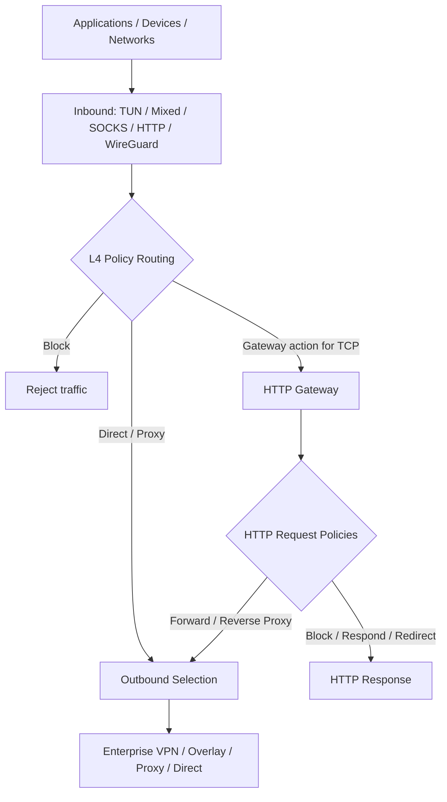

<p align="center">
  
</p>

<h1 align="center">Yuhaiin</h1>

<p align="center">
  <strong>Unified Network Security & Connectivity Toolkit</strong><br />
  Zero Trust-ready networking · Traffic policies · Enterprise VPN · HTTP Gateway · Modern proxy
</p>

<p align="center">
  <a href="https://github.com/Asutorufa/yuhaiin/releases"></a>
  <a href="https://github.com/Asutorufa/yuhaiin/actions/workflows/go.yml"></a>
  <a href="https://github.com/Asutorufa/yuhaiin/blob/main/LICENSE"></a>
  <a href="https://pkg.go.dev/github.com/Asutorufa/yuhaiin"></a>
</p>

**One engine. Many networks. Consistent traffic policies.**

Yuhaiin is an open-source, cross-platform networking toolkit that brings enterprise VPN connectivity, encrypted overlay networks, policy-based routing, traffic control, and HTTP application gateways into one extensible engine. Connect to different networks and services, control where traffic goes, and apply L4/L7 policies and optional bandwidth limits without maintaining a separate proxy stack for each protocol.

> **Scope:** Yuhaiin provides building blocks for Zero Trust-style network access. It is **not** a complete ZTNA platform, identity provider, endpoint security product, or host-wide firewall.

## Why Yuhaiin?

- **Connect across network boundaries.** Use enterprise VPN clients, mesh/overlay networks, and modern proxies within one application.
- **Enforce traffic decisions centrally within the process.** Route, proxy, or block connections based on destinations, applications/processes, inbound sources, and rule priority.
- **Handle application traffic with HTTP Gateway.** Apply request-level policies, reverse proxy to backends, and choose existing outbound nodes per request.
- **Keep networking flexible.** Reuse a lightweight userspace TCP/IP stack for supported integrations, including VPN/overlay use cases that do not require a new host TUN interface.
- **Control congestion and resource use.** Apply optional upload/download rate profiles, bound connection and NAT resources, and choose FIFO or fair output scheduling for the lightweight TUN stack.

## Core Capabilities

| Capability | Highlights |
| --- | --- |
| **Traffic Security & Policy Routing** | L4 allow/route/block decisions; domain, IP, port, process, and inbound-based rules; DNS and FakeIP integration |
| **Traffic Control & QoS** | Optional hierarchical upload/download limits with burst allowances; global/inbound/route profiles; connection and NAT resource budgets; lightweight TUN FIFO or FQ-CoDel scheduling; diagnostics |
| **Enterprise VPN & Overlay Networking** | Corporate SSL/IPsec VPN clients, WireGuard, Tailscale, Nebula, ZeroTier, and related encrypted networking protocols |
| **HTTP Gateway & Application Proxy** | HTTP/HTTPS reverse proxy, Host/Path/Header conditions, rewrites, redirects, URL filtering, upstream health checks and balancing, optional TLS interception |
| **Unified Proxy Engine** | TCP/UDP handling, transparent proxy, proxy chains, selectable outbounds, connection visibility, cross-platform clients |

### How traffic flows



The HTTP Gateway is **optional**: ordinary connections continue through L4 routing without HTTP inspection. HTTPS interception is opt-in and requires an explicitly configured CA, target allowlist, and client trust. GREASE ECH can be inspected as ordinary TLS; real ECH inner traffic and HTTP/3 are not decrypted. The Gateway does not bypass certificate pinning.

## Supported Connectivity

| Category | Protocols and integrations |
| --- | --- |
| **Enterprise VPN clients** | OpenVPN, GlobalProtect, AnyConnect, Fortinet SSL VPN, IKEv2/IPsec, SSTP, SoftEther |
| **Mesh & overlay networking** | WireGuard, AmneziaWG, Tailscale (tsnet), Nebula, ZeroTier, Cloudflare WARP |
| **Modern proxies & tunnels** | Shadowsocks, ShadowsocksR, VMess, VLESS, Trojan, Hysteria 2, MASQUE, SSH |
| **Standard proxy & ingress** | SOCKS4a/5, HTTP, Mixed, TUN, Redir, TProxy, WireGuard inbound |
| **DNS transports** | Classic DNS over UDP/TCP, DoT, DoH, DoQ, FakeDNS |

**Support varies by protocol and platform.** Some integrations remain experimental or have restricted transport/authentication modes. Nebula and ZeroTier are userspace outbound integrations, not general-purpose virtual Ethernet adapters. Check the linked implementation guides for supported features, packaging requirements, and limitations.

## Traffic Control & QoS

Traffic control shares one policy and resource-governor implementation across inbound streams, ordinary TCP relays, HTTP Gateway interception, and NAT/UDP paths. Configure it in the web UI or through the `traffic_control.get`, `traffic_control.put`, and `traffic_control.status` RPC endpoints.

- **Bandwidth profiles.** Set independent upload/download limits for the global engine, individual inbounds, and selected L4 route rules. Applicable limits compose, and profiles use token buckets with configurable burst capacity. The UI displays decimal Mbps; the API stores bytes per second.
- **Connection and NAT protection.** Bound concurrent sessions and queued resources to reduce the impact of overload. TCP stream shaping applies backpressure, while UDP packets exceeding their admission limit are dropped rather than delayed.
- **Lightweight TUN scheduling.** Choose `fifo` (default) or explicitly select `fq_codel` using `outputScheduler`. FQ-CoDel groups traffic by destination host and flow, using deficit round-robin fairness and active queue management to reduce domination by backlogged flows. This selector applies to the **lightweight** stack, not gVisor, TUN2Socket, or the physical WAN interface.
- **Persistence and diagnostics.** Policy is persisted in SQLite and activated atomically. Status reports bounded global, NAT, inbound-scope, and supported output-queue counters, including admission rejection and queue drops.

**Defaults and limits:** Bandwidth shaping is **disabled by default**, while resource admission budgets and lightweight output scheduling remain available. Enabling shaping does **not** automatically enable FQ-CoDel. Limits account for admitted client-facing bytes and UDP payloads, not physical-wire bytes or tunneling/retransmission overhead. Host-based fairness does not identify authenticated users.

See the [traffic-control architecture and configuration](docs/traffic-control/README.md) and [qualification and benchmark results](docs/traffic-control/benchmarks.md) for implementation details, overhead measurements, and remaining platform/latency validation limits.

## Typical Use Cases

**Enterprise network access.** Connect to a corporate VPN endpoint while retaining application-aware routing, local DNS behavior, and rules for other traffic.

**Private service connectivity.** Reach resources through WireGuard or an overlay network such as Tailscale, Nebula, or ZeroTier, using the same outbound selection model as other proxies.

**Application gateway.** Expose an HTTP/HTTPS service, select backend pools and outbound paths, apply Host/Path/Header policies, and optionally block unwanted URLs.

**Transparent traffic control.** Send selected system or application connections through TUN/TProxy/Redir, enforce L4 policies, and optionally apply per-inbound or per-route bandwidth limits. On lightweight TUN, opt into FQ-CoDel when competing flows need fairer output scheduling.

## Platforms

- **Linux**, **macOS**, and **Windows** for desktop and server-oriented deployment.
- **Android** via the [Yuhaiin Android client](https://github.com/yuhaiin/yuhaiin-android).

Availability of specific inbound modes, native VPN libraries, and platform integrations differs across builds.

## Quick Start

Download a build from [GitHub Releases](https://github.com/Asutorufa/yuhaiin/releases), or build/install from source:

```bash
# Build from the repository
make yuhaiin

# Or install the Go command
go install github.com/Asutorufa/yuhaiin@latest

# macOS (Homebrew)
brew tap yuhaiin/yuhaiin
brew install yuhaiin
```

On macOS, manually downloaded unsigned binaries may require removing quarantine and an ad-hoc signature:

```bash
xattr -rd com.apple.quarantine yuhaiin
codesign -s - yuhaiin
```

Start the service:

```bash
yuhaiin -host="127.0.0.1:50051" -path="$HOME/.config/yuhaiin"
```

Open **http://127.0.0.1:50051** to configure your inbounds, nodes, routing policies, traffic control, and HTTP Gateway. The management endpoint above is local by default; configure authentication and exposure deliberately before using a non-loopback listener.

> For a local proxy, configure or enable a **Mixed inbound** (commonly port **1080**). The HTTP management address (`50051`) is a separate service, not the proxy port.

## Screenshots

The current web UI:


## Documentation

- [HTTP Gateway architecture](docs/gateway/architecture.md) · [Configuration](docs/gateway/configuration.md) · [HTTPS interception](docs/gateway/interception.md)
- [Gateway reverse proxy](docs/gateway/reverse-proxy.md) · [Benchmarks](docs/gateway/benchmarks.md)
- [Traffic control](docs/traffic-control/README.md) · [Traffic-control benchmarks](docs/traffic-control/benchmarks.md)
- [WireGuard inbound](docs/wireguard-inbound.md) · [Hysteria 2](docs/hysteria2.md)
- [OpenVPN](pkg/net/proxy/openvpn/README.md) · [GlobalProtect](pkg/net/proxy/globalprotect/README.md) · [Nebula](pkg/net/proxy/nebula/README.md) · [ZeroTier](pkg/net/proxy/zerotier/README.md)
- [SSH outbound](pkg/net/proxy/ssh/README.md) · [Rules](https://github.com/yuhaiin/kitte) · [Android client](https://github.com/yuhaiin/yuhaiin-android)

## Security Boundaries

Yuhaiin's routing rules and traffic-control limits apply to traffic entering its configured inbounds; they do not automatically replace the operating system's firewall or guarantee physical-link shaping. Gateway TLS interception is disabled by default and requires explicit configuration and client trust. Enterprise VPN support refers to interoperating as a client with supported protocols; it does not imply built-in SSO, device posture assessment, centralized policy distribution, high availability, or enterprise compliance certification.

## Community & Acknowledgements

Yuhaiin builds on the broader Go networking and open-source ecosystem, including [gVisor](https://github.com/google/gvisor), [Tailscale](https://github.com/tailscale/tailscale), and many protocol projects and contributors. See the repository history, dependencies, and individual integration documentation for attribution.

<details>
<summary>Acknowledgements and references</summary>

- [Go](https://go.dev/)
- [gVisor](https://github.com/google/gvisor)
- [プロ生ちゃん](https://kei.pronama.jp/)
- [Tailscale](https://github.com/tailscale/tailscale)
- [usque](https://github.com/Diniboy1123/usque)

References: [tun2socks](https://github.com/xjasonlyu/tun2socks), [shadowsocksR](https://github.com/mzz2017/shadowsocksR), [go-shadowsocks2](https://github.com/shadowsocks/go-shadowsocks2), and [vmess-client](https://github.com/gitsrc/vmess-client).

</details>

Contributions, bug reports, and reproducible interoperability tests are welcome.
